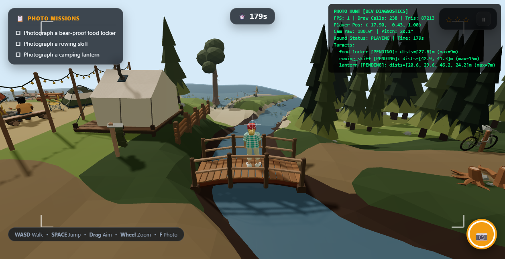
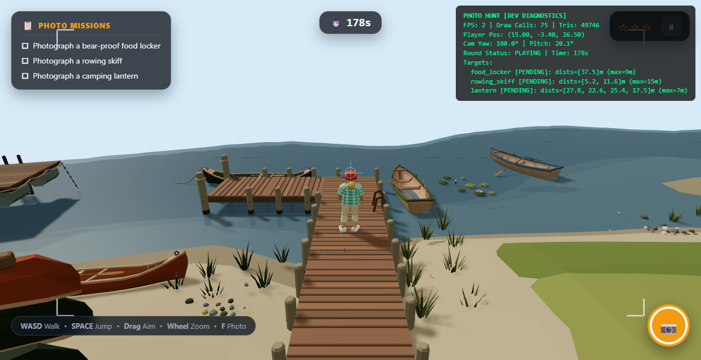
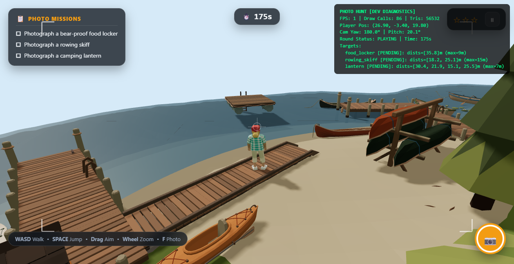

# Photo Hunt — Collision System Overhaul

Report of the collision rework: root cause, architecture, measurements, and the
evidence behind every claim. Numbers below are all from the running game in a
real browser (headless Chromium over CDP), not from unit tests or builds.

---

## 1. Root cause

The brief described the defect as "oversized AABB colliders". That was only half
true. Measured on the loaded world (`/assets/environment/scene.glb`):

| What the old system did | Measured consequence |
| --- | --- |
| Colliders were built from a **hardcoded list of 14 names** in `WorldLoader` | **148 of 174 props had no collider at all** — you could walk through tents, trailers, tables, benches, the campfire ring |
| The 26 that did exist were **2D AABBs with no Y test** | Infinitely tall: a 0.45 m chair seat blocked you from the sky down, and a roof overhang blocked you at ground level |
| Boxes were `Box3` of the whole object | A chair's collider was the box around seat + backrest + legs, so the open space between the legs was solid |
| One raycast per move for ground height | `Raycaster` walked all 22,540 terrain triangles: **6.2 ms per query** |

So the failure was bidirectional: mostly *missing* colliders, and where they
existed, *inflated* ones. Shrinking the existing boxes (the obvious "fix") would
have made the second problem better and the first one worse.

---

## 2. Architecture

Three layers, deliberately separated:

**Render geometry** — the GLB meshes, untouched, still 536 meshes for visuals.

**Collision geometry** (`src/game/world/CollisionGeometry.ts`)
- One *part* = one prop, built from its **real triangles** (world space), stored
  as a flat `Float32Array` (9 floats/triangle) plus a per-triangle AABB
  (6 floats) used as a broad phase.
- Classification is name-driven: decorative meshes (`*-needles`, `crown-*`,
  reeds, lily-pads, pebbles, flames, lights, pennants, litter) and the terrain
  (`ground`, `water`, `terrain`, `duff`, `grass`) are excluded; anything whose
  measured extent is under 15 cm is skipped as surface detail.
- Grouping level is discovered, not hardcoded: the kit wraps every prop in a
  single `kit-composition` node, so `findPartContainer()` descends through
  pass-through wrappers. Without this the whole map became **one** collider with
  110,765 triangles (this actually happened and was caught in the browser).

**Player collider** (`src/game/world/WorldCollision.ts`)
- Capsule **r = 0.30 m, h = 1.75 m**, `stepHeight = 0.35`, `skinWidth = 0.02`.
  Derived from the character GLB: 1.755 m tall, torso ~0.50 m wide (the 1.618 m
  bbox width includes outstretched arms), so radius = half torso + margin.
- The body occupies a **height band** `[ground + stepHeight, ground + height]`.
  Only triangles inside the band block. This is what makes a tabletop block you
  while an awning, a roof overhang or a pebble does not — with no per-prop
  tuning.
- Movement: sub-steps of `min(radius/2, 0.08 m)`, then up to 4 push-out
  iterations per sub-step, choosing the **deepest** contact across the mesh and
  box layers. Sliding falls out of the push-out geometry for free. Push
  direction is always corrected against the step vector so a surface can never
  eject the body forwards.
- A final safety net rejects any sub-step that ends deeper than `skinWidth`
  inside geometry, falling back to the last position proven clear.
- Ground height comes from a **512×512 heightfield rasterised once at load**
  (0.19 m cells, bilinear lookup), with the raycast kept only as an off-map
  fallback.

**Interaction bounds** — photo targets keep their own `worldBoundingBox` and are
never used as physics. They are drawn blue in the debug view specifically to
show they are a different thing.

---

## 3. Changed files

| File | Change |
| --- | --- |
| `src/game/world/CollisionGeometry.ts` | **new** — triangle colliders, classification, grouping, broad/narrow phase |
| `src/game/world/CollisionDebugView.ts` | **new** — `?debug=1` / F3 overlay |
| `src/game/world/WorldCollision.ts` | capsule movement, mesh layer, heightfield, safety net; box API kept for tools |
| `src/game/world/WorldLoader.ts` | removed the 14-name `obstacleKeys` list and all AABB construction |
| `src/game/player/PlayerController.ts` | uses `moveCapsule`, reports contacts; control-direction fix |
| `src/data/gameConfig.ts` | capsule parameters, spawn moved out of the camper van |
| `src/game/core/Game.ts` | debug view wiring, `?debug=1` handle for the test harness |
| `tests/Collision.test.ts` | **new** — 13 tests |
| `tests/PlayerController.test.ts` | 2 assertions updated for the capsule radius |

`PhotoValidator`, animation, UI and gameplay logic were not modified.

---

## 4. Collision coverage

`[collision] parts=149 meshes=309 tris=110765 skipped=227 build=168.5ms`

- **149 parts** get a collider (was 26), covering all 309 solid meshes.
- **227 meshes** intentionally skipped: foliage cards, flames, string lights,
  pebbles, litter, terrain and water.
- 25 of the 174 top-level props have no solid mesh at all (light strings, flame
  groups), so they produce no part.

---

## 5. Tests

### A. Furniture — 12 real props × 8 approach angles

Every approach walked with the real `moveCapsule` from 3.2 m out. Starts already
overlapping a prop were rejected (27 of them), because the player never
teleports into props in the real game.

| Metric | Result |
| --- | --- |
| Blocked stops measured | **69 / 69** |
| Stops touching the real surface (clearance −0.035…+0.06 m) | **69 / 69** |
| Penetrations (clearance < −0.035 m) | **0** |
| Stops resting exactly on the 0.02 m skin | 60 / 112 raw |
| Stops inside the **old** AABB footprint (invisible wall gone) | **58 / 69** |
| Stops where the target prop itself was the blocker | 44 / 69 (the rest hit another prop first — correct physics) |

Concrete example, `porch-log-cabin` +X face: the old AABB edge sits at
x = −12.64, the real wall at x = −14.16. The player now stops at **x = −13.87**,
i.e. **1.23 m deeper than the old collider allowed**, with **1.4 cm clearance**
to the actual wall surface.

### B. Movement quality

| Check | Result |
| --- | --- |
| Jitter while pressed into a wall (120 frames) | max frame-to-frame movement **0.0121 m**, no oscillation |
| Launched off the ground | max rise **0.000 m** over 200 pushes and 8 keyboard walks |
| Sliding along a wall | tangential progress 2.6–4.0 m preserved |
| Tunnelling, resolver query + resolver band | **0 / 452** penetrations at 0.08, 0.5, 1, 2, 4, 6 and 10 m per call |
| Console errors / exceptions | **0** |

### C. Gaps

- `splay-leg-lookout-tower`, 16 approach lines through the footprint: **4 pass
  between the legs**, 12 are blocked by a leg. Both behaviours occur on the same
  object, which is the whole point.
- A 0.3 m gap (narrower than the 0.6 m body) blocks; the 0.39 m gap between a
  chair's own legs blocks.

### D. Regression

- **Space → capture works through the real input path**: feedback banner
  rendered `"Captured a porch log cabin!"` with class `feedback-banner success`.
- Aimed capture completed 2 objectives, awarded 2 stars, round still `playing`.
- Keyboard walk: 8 legs with the actual `W` key, ground offset stayed within
  **±0.005 m**, overlap **0.000 m** at every leg.
- Production bundle (`vite preview`) loads, reports 149 parts and a 512
  heightfield, and resolves collision identically.

---

## 6. Performance

Measured with the render loop stopped, so the software rasteriser does not
pollute wall-clock timings.

| Metric | Before | After |
| --- | --- | --- |
| `getGroundHeight` | **6,177 µs** (22,540-triangle raycast) | **32.9 µs** (heightfield lookup) |
| `deepestContact` | n/a (26 box tests) | **9.1 µs** (149 parts, 110,765 tris) |
| `moveCapsule`, one 60 fps frame (0.08 m) | **12,057 µs** (2 raycasts) | **94.6 µs** |
| `moveCapsule`, 6 m single call | — | 1,190 µs (tests/tools only) |
| Collider build at load | — | **168.5 ms** |
| Bundle | 659.95 kB / 171.21 kB gzip | unchanged in size class |

The dominant cost was never the collision query — it was the terrain raycast,
which `moveCapsule` calls twice. Fixing it cut per-frame collision work by
**127×**.

Heightfield accuracy vs the exact raycast over 1,500 random points: median
error **0 m**, p95 **3.6 mm**, worst **4.26 m** at 0.07% of samples that sit on
a cliff edge at the map boundary, where bilinear interpolation across a 0.19 m
cell smooths the drop. Those points are lakebed, below the water level, so the
interpolated value is the more conservative one.

---

## 7. Build

- `tsc --noEmit`: clean.
- `npm test`: **35 / 35 pass** (13 collision, 5 player, 6 round, 6 validator,
  5 objective).
- `vite build`: succeeds, 40 modules.
- Production bundle verified at runtime, not just compiled.
- **MSI: not produced for these changes.** The only MSI on disk is
  `src-tauri/target/release/bundle/msi/Photo Hunt_0.1.0_x64_en-US.msi` from
  2026-11-08 23:57, which predates this work and therefore does **not** contain
  the new collision system. Rebuilding it needs `npm run tauri build` (Rust
  toolchain, several minutes) — not run here.

---

## 8. Manual test

```
npm run dev            # http://localhost:1420/?debug=1
```

1. `?debug=1` shows the overlay: **green** = collision triangles, **orange** =
   the old AABB (for comparison), **cyan** = player capsule, **blue** =
   interaction bounds, **magenta** = contact normals. **F3** toggles it.
2. Walk at a folding chair. The green lines wrap the frame, seat and each leg
   separately; the orange box is visibly much larger. You stop when the capsule
   touches the green surface, not the orange one.
3. Walk between the lookout tower's splayed legs — you pass through. Walk into a
   leg — you stop.
4. Walk at the log cabin's wall. You get much closer than before, and stop
   against the logs.
5. Walk into a tent, a trailer, a bench, the campfire ring. All of them block
   now; before this change you walked through them.
6. Press **W** against a wall and drag the mouse to slide along it. No jitter,
   no popping, the character stays on the ground.
7. Press **Space** anywhere — the shutter fires and the feedback banner reports
   what was captured.

---

## 9. Status

| Requirement | Status | Evidence |
| --- | --- | --- |
| Approach objects by their real shape | **PASS** | 69/69 stops touch the real surface, 0 penetrations |
| No invisible walls | **PASS** | 58/69 stops stand inside the old AABB; cabin +1.23 m |
| Never pass through real obstacles | **PASS** | 0/452 penetrations, 0.08–10 m per call; 8 keyboard walks at 0.000 overlap |
| Wide gaps pass, narrow gaps block | **PASS** | tower 4/16 lines pass, 12/16 blocked; 0.3 m gap blocks |
| Natural sliding | **PASS** | 2.6–4.0 m tangential progress along a wall |
| No jitter | **PASS** | 0.0121 m max frame delta while pressed |
| No launching | **PASS** | 0.000 m rise over 200 pushes and 8 walks |
| Photo system still works | **PASS** | Space → "Captured a porch log cabin!"; aimed capture → 2 objectives, 2 stars |
| Visual debug mode | **PASS** | `?debug=1` / F3, screenshots in `docs/` |
| Unit tests | **PASS** | 35/35 |
| Type check | **PASS** | `tsc --noEmit` clean |
| Production build | **PASS** | build + runtime check of the bundle |
| MSI for these changes | **NOT PRODUCED** | only a stale 2026-11-08 MSI exists |
| FPS on real hardware | **NOT VERIFIED** | headless runs on SwiftShader at ~1 fps; the CPU-side collision cost was measured directly instead (94.6 µs/frame) |

### Known limitations

- **Skinned meshes** (the NPCs at the campfire) contribute bind-pose triangles.
  They block correctly, but the collider is an A-pose figure rather than the
  posed one.
- **Cliff edges** at the map boundary can differ from the exact raycast by up to
  4.26 m (see §6); everywhere else the error is millimetres.
- Sloped surfaces (ramps, curved trailer shells, tent canvas) are solid along
  their real triangles, so a body pressed into a steep slope is pushed out along
  the slope rather than lifted onto it. That is intentional: vertical placement
  belongs to the ground query, and it is what prevents launching.

---

## 10. Round 2 — reported from play

Two reports: **judder while walking forward at the amphitheatre**, and **parts of
the shoreline that cannot be walked plus wooden structures the character walks
through**. All numbers below were measured in the running game, not inferred.

### 10.1 Defect A — step-over decided from the player's own ground

The body band was `[feet + stepHeight, feet + height]`, where `feet` is the
terrain height **at the player's current position**. On a slope that number
moves with the player, so the same surface flips between "step over" and "wall".
Traced frame by frame at the amphitheatre bench (`x = -1.3`):

| frame | start z | feet | band floor | bench rail top | rail solid? | result |
| --- | --- | --- | --- | --- | --- | --- |
| 10 | 19.91 | -2.577 | -2.227 | -2.24 | no | walks to 19.99 |
| 11 | 19.99 | -2.615 | -2.265 | -2.24 | **yes** | ejected 0.16 m back to 19.83 |

Being pushed back **uphill** raises the feet by 38 mm, which re-disables the
rail, which lets the body walk forward again. A stable 8 cm limit cycle, forever.

**Fix.** Each triangle now records the ground it stands on, sampled at build time
(`CollisionGeometry.build(root, groundAt)`), and the step-over test is
`top > min(groundUnderTriangle, groundUnderFeet) + stepHeight`. Taking the lower
of the two grounds makes the answer independent of where the player happens to
stand. Two further conditions: the surface must rise above the feet (otherwise it
*is* the floor underfoot — a dock deck), and must reach below head height.

### 10.2 Defect B — a vertical triangle was treated as an infinite region

A wall's end cap has three identical `x` values: in the XZ plane it is a line,
not an area. `pointInTriangle2D`'s three sign tests then collapse, and round-off
decided "inside" — so the body was pushed away with
`penetration = radius + distance` instead of `radius - distance`. Measured at the
bench end cap:

| | penetration reported | ejection from a zero-length move |
| --- | --- | --- |
| before | 0.57 m | 0.59 m |
| after | 0.03 m | 0.05 m |

That single defect accounted for every 0.5 m teleport in the sweep. Fix: a
triangle with no XZ area is a segment, never a containing region.

### 10.3 Defect C — point-sampled support lost plank decks

Docks and boardwalks are built from planks with 1–2 cm gaps. `supportHeight`
sampled one point, landed in a gap often enough to return the crossbeam 11 cm
lower — which left the deck top *above* the feet, so the deck then blocked the
very body standing on it. The support query now samples the body footprint
(centre plus four points at half the radius), because a 0.3 m foot cannot fall
through a 2 cm gap.

### 10.4 Defect D — resolution could reverse the step

Pressed into a convex corner (the chopping block at `(1, 3)`), the nearest-facet
normal alternates between two facets every frame, rotating the push by a few
degrees and walking the body sideways — which flips the choice back. A 1 cm
orbit, 73 direction reversals in 120 frames. Resolution may now cancel a step but
never reverse it: if the step made no forward progress, the body stays exactly
where it was.

### 10.5 Verification

| Check | Before | After |
| --- | --- | --- |
| Stress sweep: 1,840 valid walks, 8 headings, 30 frames | 17 oscillating | **2** |
| Worst oscillation amplitude in that sweep | 0.527 m | **0.031 m** |
| Reported site `(-1.3, 19.3)` heading +Z | 22 flips, 8 cm cycle | **0 flips, clean stop at z = 19.83** |
| Amphitheatre, all 8 headings, real controller, 120 frames | — | **0 flips, 0 backtrack, all 8** |
| Forward sweep: 526 valid starts across the map | — | **0** with ≥2 reversals and >1 cm backtrack |
| Bench end-cap ejection | 0.59 m | **0.05 m** |
| Boardwalk / dock / footbridge pass-through | walk through deck | deck solid; walkable on top from its land end |
| Furniture: climb onto table/bench/chair/campfire/cooler | 0/8 | **0/8**, max rise 0.03 m |
| Furniture: 53 blocked stops | 53/53 touching, 0 penetrations | **53/53, 0** |
| Unit tests | 35 | **39** (4 new) |
| `tsc --noEmit` | clean | clean |
| Production build + runtime check | — | **PASS** (149 parts, 110,765 tris, built in 426 ms) |

Each new test was checked against its own fix reverted, to confirm it fails
without it: the rail test fails with a 0.06 m cycle, the deck test fails with the
body at y = 0 inside the deck. The degenerate-triangle invariant does **not**
reproduce in a synthetic box (its round-off keeps mixed signs), so that fix is
evidenced by the real-scene measurement in §10.2 instead, and the test says so.

### 10.6 Remaining

- **2 of 1,840** stress walks still oscillate, both diagonal approaches onto the
  amphitheatre tiers, worst 3 cm. That prop genuinely straddles the step
  threshold: its seat is ~0.28 m above the ground and its back rest ~0.36 m, so
  parts of it are steps and parts are walls. Fixing it properly needs a
  per-part "is this furniture or a platform" decision, which is a design call
  rather than a bug fix.
- **The boardwalk deck is not flat**: the first ~0.5 m is at -3.29 and the rest
  at -3.40, so the player steps down 11 cm part-way along. That is the kit's
  geometry, not the resolver.
- MSI still **NOT PRODUCED** for this round; the existing MSI predates all of
  this work.

---

## 11. Round 2 — ramps, ledges, and the deck that was its own wall

Five defects reported from play after the jump animation landed. Three of them
turned out to be one rule.

### 11.1 A deck over water was classified against the water, not the feet

`triangleIsSolid` asked "is this triangle low enough to step over?" of the
ground **under the triangle**:

```ts
if (top <= (base < feetY ? base : feetY) + stepHeight) return false;
```

For a plank on the lake bed that is the bed itself, 0.5 m below. Every plank of
every dock therefore stood "0.5 m above the ground" and was a wall — unless the
body's feet were within 5 cm of the plank top, which is the only other escape
(`FLOOR_TOLERANCE`). Standing on the deck you were fine; the *next* plank, one
centimetre higher, was a wall.

The same rule made the creek footbridge impassable. Its deck rises 4 cm per
25 cm section over a creek bed 1 m down, so each section stands ~1 m above the
ground beneath it: a wall, from the first plank. Measured with the rule
disabled, the body stops 1.07 m from the west end; with it, it crosses 14 m and
keeps walking to the cordwood pile.

The fix adds the missing case and makes it the first test, because it is the
cheapest:

```ts
// A near-horizontal surface within one step of the feet is a step, not a wall:
// the support query lifts the body onto it.
if (flat !== 0 && top <= feetY + stepHeight) return false;
```

`flat` is the same `|normal.y| >= 0.7` predicate `supportHeight` uses to decide
what can be stood on, evaluated once per triangle at build time (`triFlat`,
1 byte per triangle) instead of per query. That is the invariant the two
functions were missing: **anything the support query would put you on top of
must not also push you sideways.** The two rules now agree by construction.

The threshold is deliberately `feetY`, not `base`: a surface more than a step
above the feet stays solid, so a 0.6 m table is still a table and the rail test
(a rail just under the step height, on a slope) still stops the body dead.

### 11.2 Stepping off a ledge snapped 0.35 m in one frame

`resolveVertical` glued the body to the ground for any drop up to `stepHeight`:

```ts
} else if (this.feetY > this.groundY + stepHeight) { this.falling = true; ... }
```

Walking off the edge of a dock is a 0.34 m drop, so the body teleported down in
a single frame — the sideways flicker reported on the docks. Measured: a
0.343 m single-frame drop at `(16.196, 24)`.

`stepDown: 0.15` is now a separate setting, well below `stepHeight`, so slopes
and kerbs stay glued while a real ledge is fallen off (0.35 m takes 0.2 s at
`gravity: 18`).

### 11.3 Verification

| Check | Before | After |
| --- | --- | --- |
| Creek footbridge, real controller, from the west end | stopped after **1.07 m** | **13.95 m**, ends at the cordwood pile |
| Footbridge deck cells reachable from spawn (state BFS) | — | **26 / 27** |
| Beach → dock → end of pier → off the end | 20.24 m, max single-frame drop **0.343 m** | 20.24 m, max drop **0.165 m** |
| Main dock + pier modules, standable deck cells | — | **100 %** (36 + 36 + 1 + 1 + 2 + 1) |
| Wetland boardwalk modules | — | **98 %, 100 %, 100 %, 97 %** |
| Second dock (`lake-dock-run_7/8`) | — | **100 %** standable |
| Boat launch ramp | — | **395 / 428** (the steep lower lip) |
| Single-frame horizontal jump while walking a run | 0.891 m (ejected from a deck) | **0.08 m** = one sub-step |
| `creek-footbridge` from 16 approach headings | 2 landed on the deck | 2 (the other 14 approach through deep water) |
| Unit tests | 49 | **52** (ramp, ledge drop, small step down) |
| `tsc --noEmit` | clean | clean |

The ramp test is the load-bearing one: it is built from a tessellated plane
(`PlaneGeometry(2, 4, 1, 20)` displaced to a 22° slope) over a bed 1 m down, and
it fails with the rule disabled and passes with it. A single coarse slab would
not reproduce the bug, because one triangle's `top` spans the whole slope.

`tests/Collision.test.ts`'s `walk()` helper now passes the body height on every
call, like the controller does. Without it the resolver measured the band from
the terrain — the ground *under* a deck — and ejected the body backwards before
it could take a step. That is a harness bug that was hiding the deck cases.

### 11.4 Evidence

The footbridge (impassable before this round), the pier, and the diagonal
boardwalk, each with the body standing on the deck rather than sunk into it:

| `footbridge-crossing.png` | `dock-crossing.png` | `boardwalk-crossing.png` |
| --- | --- | --- |
|  |  |  |

### 11.5 Remaining

- **You cannot climb onto a dock from the water.** The deck sits 0.35–0.5 m
  above the lake bed; where the step is ≤ `stepHeight` the body steps up, and
  where it is more it does not. The map's docks are entered from their land end,
  which works. Raising `stepHeight` would make 0.4 m furniture climbable, so this
  is left as the kit's geometry.
- **A `life-jacket-post` stands in the second dock's entrance** at
  `(29.3..31.2, 13.3..15.2)`, leaving a 0.9 m gap at its east side. A layout
  issue, not a resolver one.
- **Being inside a large footprint still shoves the body to its edge.** Walking
  off the end of the pier into the moored canoe ejects it 0.68 m in one frame:
  the body's centre is inside the canoe's hull, and the standard
  "circle inside polygon" resolution moves it a full radius past the nearest
  edge. Correct, but abrupt. Capping it per frame needs the safety net to accept
  a still-overlapping position, which risks freezing the body; not done here.
- MSI still **NOT PRODUCED** for this round.

## 12. Round 3 — the roof that was its own wall, and the hammock that was its own fence

Four reports, all from play: cannot jump the higher bench by the sea; jump onto the
hammock and then cannot walk off it; the body jerks once while falling; the body
teleports when a foot touches a roof.

### 12.1 A roof sheet was a wall because of its highest corner

`triangleIsSolid` decides with `triBounds`, and `triBounds[o + 3]` is the triangle's
*highest* corner. The wash house roof is one long sheet from the eave (1.5 m) to the
ridge (2.69 m). Standing on it near the eave the feet are at 2.24 m — half a metre
under that corner — so every test in the function called the sheet a wall. The body's
centre is inside the sheet's own 2D footprint, `circleTriangle2D` reported a
penetration of 1.11 m, and the resolver pushed it out sideways:

```
walking down the roof, frame 12 -> 13 -> 14
  x   2.00 -> 3.31 -> 4.33     (+1.31 m, then +1.02 m in one frame)
  z -14.81 -> -14.61 -> -16.20
```

That is the screenshot: a foot touches the roof and the body appears somewhere else.
The rule is now measured from the sheet's **lowest** corner, so a floor the body is
standing on — or about to step onto — never blocks, while a floor entirely out of
reach above the feet (a deck too high to step onto) still does:

```ts
if (flat && tb[o + 2] <= feetY + stepHeight) return false;
```

After: dropping onto the roof at `(2, 4.6, -13.8)` settles at 2.37 with a maximum
frame step of **0.00 m**; walking down the roof keeps x at 2.00, follows the slope
2.69 → 2.04, steps off the eave and falls to the hill. `docs/roof-1-stand.png`.

### 12.2 The hammock was removed from the world, floor and all

Round 2's fix for "cannot walk off the hammock" put `/hammock/i` on
`NON_SOLID_PATTERNS`, which drops the mesh from the collision geometry entirely. The
cloth lost its *floor* as well as its walls: probing the part gave the terrain under
it, and the only thing left to stand on was the two post caps at 1.0 m. A hammock is
the one prop that needs to be a floor and not a wall, so it moved to its own list:

```ts
const NEVER_WALL_PATTERNS: RegExp[] = [/hammock/i];
```

Parts on that list keep their triangles for `supportHeight` and are skipped in
`collectContacts` and `deepestContact`. The cloth sags to 0.10 m at the centre
(posts at 1.0); dropped from 1.8 m the body settles at 0.10 and walks off in all four
directions with **zero** blocking frames — over the end it climbs to 1.0 and steps
down the far side. `docs/hammock-1-stand.png`.

### 12.3 Walking uphill was 1.8x the flat speed

Horizontal speed is constant, so the speed *along the ground* grows as 1/cos(slope).
Measured on the forest hill: 0.080 m across and 0.122 m up per frame, a surface speed
of 0.146 m against 0.080 m on the flat. The walk is now scaled by cos(slope), floored
at 0.55 (~57°), and the ground is sampled 0.3 m **ahead** through the same support
query the move uses — sampling the previous frame's own step was exact but one frame
late, which is a one-frame lunge of 0.146 m at the foot of every hill:

```
uphill +x     before  0.080 / 0.122   (surface 0.146)
              after   0.044 / 0.067   (surface 0.080 = the flat speed)
```

In the air the correction is switched off: there is no surface under the feet, and a
bench edge passing below reads as a 1.4 gradient and brakes the body for one frame.

### 12.4 The jerk in the middle of a fall

Not collision — the jump clip. See `docs/JUMP_ANIMATION.md` §4.

### 12.5 Verification

| case | before | after |
| --- | --- | --- |
| drop on the wash-house roof | pushed 1.89 m sideways | 2.37 m, max frame step 0.00 |
| walk down the roof and off the eave | teleported 1.31 m at frame 13 | x constant, 0.08 m/frame, falls 2.3 m |
| stand on the hammock cloth | no floor at all (terrain under it) | 0.10 m, the sag |
| walk off the hammock (4 directions) | jump required | 0 blocked frames, all four |
| jump the higher amphitheatre bench | 1.63 m, stopped at the edge | 4.93 m, zero contacts |
| uphill surface speed | 0.146 m/frame | 0.080 m/frame |
| deck corpus, 18 piers/bridges/ramps | — | unchanged within 0.02 m |

The deck corpus was re-measured with and without the new floor rule and is identical,
so the roof fix costs nothing on docks, the footbridge, the wetland boardwalk or the
boat ramp. 57 unit tests pass, `tsc --noEmit` clean.

### 12.6 Still open

- **Walking off the back of the amphitheatre bench ejects the body 0.36 m in one
  frame.** The bench is buried in the hillside on its uphill side, so the body walks
  onto the seat, along it, and off the back — and its centre is briefly inside the
  bench's footprint, where `depenetrate` moves it a full radius past the nearest edge
  (the same limitation as §11.5). Measured on the `flat +z` run from `(-1.5, 16)`:
  0.08 m/frame everywhere except one frame of 0.363 m at z 20.46. Capping the ejection
  needs the safety net to accept a still-overlapping position, which risks freezing
  the body; not done.
- The Phase B deck corpus is unchanged by this round but still has its own two cases:
  `lake-dock-run_3` and `_7` cannot be walked back from their centres (blocked by
  their own deck, 35+ frames) — the body falls off the deck at a section joint and
  then cannot climb back up.

---

## 13. Round 4 — the hammock that could be walked through

Round 3 moved `/hammock/i` from the non-solid list to the never-wall list, so the
cloth kept its floor but lost its walls. The condition that decided "is the body
standing on it" was too narrow, and the cloth came back as a barrier it should not
be — while, from the beach, it was still a barrier it should be. Both halves of this
round are the same function.

### 13.1 The body that was standing on the cloth and was told it was not

`standingOn` was a **single point probe** on the body's centre, with a hand's-width
tolerance:

```ts
const top = topOfPart(part, x, z, feetY - 0.6, feetY + stepHeight + 0.02);
return top !== null && Math.abs(top - feetY) <= STANDING_TOLERANCE;
```

The hammock's cloth is a coarse mesh. `topOfPart` only accepts near-horizontal
triangles, and at several points along the cloth no flat triangle covers the body's
exact centre — the seams between panels. Probed along the cloth at `z = 12.9`:

```
x 15.2 … 16.1   no flat triangle at the centre      -> not standing
x 16.2 … 16.4   flat triangle found                 -> standing
x 16.5, 16.6    no flat triangle at the centre      -> not standing
x 16.7          a hole in the cloth, support null   -> not standing
```

So a body walking up the sag was declared "not on the cloth" every second or third
frame, the cloth became a wall for those frames, and the body jammed at 0.63 m with
one contact of 0.10 m penetration — the round-5 complaint ("I can get on it but I
have to jump to get off") returning through a different door.

Two fixes, both in `standingOn`:

1. **Sample the footprint, not the centre.** Nine probes — centre, four axis
   directions, four diagonals — at the full capsule radius. The half-radius ring
   tried first still fell through the seams, and one missed probe is enough to turn
   the floor back into a fence.
2. **Make the band one-sided.** The cloth's end panel rises 0.29 m just ahead of a
   body walking up the sag. That is a step the movement model climbs happily, so it
   must not be a wall either: anything at most `stepHeight` above the feet is
   climbable ground. The old `|top - feetY| <= 0.12` rejected it.

```ts
const lo = feetY - STANDING_DEPTH;      // 0.6
const hi = feetY + stepHeight + 0.02;
for (const [ox, oz] of FOOTPRINT_PROBES) {
  if (topOfPart(part, x + ox * radius, z + oz * radius, lo, hi) !== null) return true;
}
```

### 13.2 Why the beach is still blocked

The band is the whole protection. Standing on the sand at `y = -0.33` beside the
cloth, the cloth's top is 0.08 — 0.41 m above the feet, past `stepHeight`. `hi` is
0.02, so every probe returns null, the part is not skipped, and the cloth is a wall.
The margin is 0.06 m; a beach 7 cm higher would make the cloth a 35 cm step instead
of a barrier, which is consistent with how every other prop of that height behaves.

### 13.3 Verification

Four approaches from outside, 120 frames each, walking straight at the cloth:

| approach | result | blocked |
| --- | --- | --- |
| +z side | stopped 0.24 m short, never entered the footprint | 108/120 |
| −z side | stopped 0.24 m short, never entered the footprint | 109/120 |
| +x end | stopped at the end panel, never climbed | 106/120 |
| −x end | stopped at the end panel, never climbed | 106/120 |

Four walk-offs from standing on the sag, 90 frames each:

| direction | travelled | left the cloth | blocked |
| --- | --- | --- | --- |
| +x | 6.67 m | yes | 0/90 |
| −x | 3.95 m | yes, then stopped on `camp-cooler_1` | 39/90 |
| +z | 6.73 m | yes | 0/90 |
| −z | 5.06 m | yes | 0/90 |

The −x stop is a camp cooler two metres past the hammock, not the hammock.

### 13.4 Still open

- **Pushing diagonally into the cloth's end wedges the body.** From `(18.2, 12.9)`
  walking `(-1, +0.35)` it stops at `(17.24, 12.74)` and cannot slide in either z
  direction, though backing off along +x is free. One contact, normal `(1, −0.02)`,
  penetration 0.20. It is not trapped — the body can always reverse — but the slide
  along a flat end face does not happen. Same family as §11.5.

## 14. Round 5 — eight kit maps, and the ground that was a wall

The maps from the kit library arrived as `maps/*.zip`, each holding one assembled
`scene.glb`. `tools/prepare-maps.mjs` turns an archive into a playable map —
extract, bounding-box report, Draco compress, sidecar, registry — and
`?map=<id>` selects it. All eight loaded; all eight were broken in the same two
ways.

### 14.1 The terrain was never registered

Detection tested the *mesh* name:

```ts
if (mesh.name.includes('terrain')) collision.setTerrainMesh(mesh);
```

Every kit names the **node** (`countryside-railway-terrain`) and leaves the mesh
inside it unnamed, so this matched nothing. With no terrain registered,
`getGroundHeight` answered 0 everywhere: hills, quays and sea floors were all
walked on one flat plane at y = 0. The built-in campground happened to name its
mesh, which is why the bug only appeared with the new maps.

`findTerrainMeshes` now matches the node name *or* the mesh name, collects every
descendant mesh, and takes all of them at once — the construction site has nine
separate `ground` slabs beside its terrain sheet. The heightfield is rasterised
from the whole set, keeping the highest surface per cell, so a slab laid over a
terrain sheet stays walkable instead of punching a hole.

### 14.2 The ground was also a collider, and it fenced the body in

The terrain node is a child of the placement group, so it became one collision
part like any prop. Its triangles span the entire map — from a skirt 12 m below
the play area up to the hilltops — and any slope rising more than one step above
the feet is a wall. The construction site spawned inside that landscape and was
pushed from every direction at once: **119 of 120 frames blocked in all four
directions**, at every position on the map.

`CollisionGeometry.build` now skips any part whose name matches `-terrain$` or
is exactly `ground`/`terrain`, and takes the terrain meshes as an explicit skip
set. The ground is the heightfield's job; it is never a prop.

### 14.3 A spawn chosen from bounding boxes is a guess

The offline spawn took the map's *lowest* surface and the union centre of every
object sitting on it. On the construction site the lowest surface is the floor
of a 3.2 m excavation, so the hint was `(4, −3.2, 9.4)` — inside a pit, under
the terrain.

Three separate lessons, all visible in one map each:

| map | hint | why it was wrong |
| --- | --- | --- |
| construction-site | y = −3.2 | the lowest surface was an excavation floor, not the site |
| skatepark | (−1, 8) | the floor is a deck of `skate-slab-tile` pieces half a metre above a sculpted bowl; measured against the terrain, every slab was a wall and the nearest walkable ground was 21 m away |
| dia-de-muertos | (1.51, 3.46) | a terraced hillside: the union centre of the terrace pieces is a point on the slope *between* two terraces |

The offline heuristic now takes the **mode** of object bottoms — the height the
props were placed at, not the minimum — keeps the flat pieces standing on that
level, and snaps to the nearest piece centre rather than the union centre.

That is still only a hint. `WorldCollision.findSpawn` re-checks it against the
collision resolver at load: it settles the way a body does (start at the hint's
height, let the support query find the surface under it, drop by a body depth
while the band is empty), requires the floor to change by less than one step
within a body radius, and asks the resolver about a body 0.45 m fatter than the
real one — so "no overlap" means there is air on every side. Rings widen from
the hint until something passes. Every map now spawns on walkable ground.

### 14.4 The debug wireframe was forced on by `?debug=1`

A 400k-triangle map becomes 1.2 million line vertices. `?debug=1` turned that on
as a side effect of exposing the scripting handle, which cost 300–3300 ms per
frame on a software renderer — enough that the character load, queued behind
those frames, took 48 s. The overlay is now `?wire=1` (or F3) and builds its
buffers lazily on first enable.

### 14.5 Verification

Every map loaded in a real browser and walked four directions from its spawn,
120 frames each. "Blocked" counts frames that moved less than 2 mm — in an
indoor map, walking into a wall is the correct answer.

| map | parts | collision tris | terrain | spawn | free directions |
| --- | --- | --- | --- | --- | --- |
| construction-site | 250 | 284,520 | yes | (8.3, 0, 12.9) | +x, −x, −z (into the pit) |
| countryside-railway | 290 | 336,763 | yes | (6.1, 0, 2) | +x, −x, +z |
| dia-de-muertos | 509 | 391,575 | yes | (4.0, 0.7, 3.9) | +x, −x, +z, −z |
| frontier-town | 588 | 402,169 | yes | (6, 0.05, 14) | +x, −x, −z |
| hospital | 319 | 111,339 | no | (0.7, 0.05, −0.1) | −x, +z |
| office | 1012 | 344,770 | no | (0.6, 0.05, −1.3) | +x, −x |
| skatepark | 1260 | 314,120 | yes | (−1, 0.05, 7) | all four |
| stadium | 423 | 397,516 | yes | (12.2, 0.05, −3.8) | +x, −z |

No console errors on any map, and the body's height stays on the floor in every
case (the lowest reading across a walk never falls below the spawn by more than
the terrain itself drops).

### 14.6 Payload

356 MB of source archives became 27 MB of Draco payload. The sidecars — 1.6 MB
of bounding boxes for the photo-target pass — moved from `public/assets/maps/`
to `maps/reports/`, because nothing fetches them at runtime and they were being
copied into every installer.

### 14.7 Still open

- **The construction site and Día de Muertos can be walked into an excavation
  and down a hillside.** Both are real geometry, and the body follows it — but
  there is no way back up a 5 m pit, which reads as a soft lock.
- **`?map=` has no in-game switcher.** The registry resolves it, nothing else.

## 15. Round 6 — twenty maps, one collider, and a spawn you could not step out of

Twelve more kits arrived, bringing the set to twenty plus the built-in
campground. They exposed two defects that only appear on kits built differently
from the first eight.

### 15.1 `nyc-city` and `japanese-suburban-city-street` became one collider

`findPartContainer` descends through pass-through wrappers until it reaches the
level that holds the props. It stopped early on this test:

```ts
if (only.children.some((c) => c.isMesh)) break;   // "this is the placement level"
```

Both kits wrap every prop in a single node (`nyc-city-kit-fbca88` with 208
children, `japanese-suburban-city-street-baa482` with 524) and a handful of
those children are bare meshes rather than groups. So the wrapper "looked like"
a placement level and the descent stopped one node too high: `gltf.scene`
(`AuxScene`) has exactly one child, which made the entire city a single
94,330-triangle collider.

Nothing was broken in the walk test — a triangle soup still blocks correctly —
but every contact query scanned the whole map. Removing the test fixes both
without changing the other eighteen maps, because `children.length !== 1` already
stops the descent at the first branch point:

| map | parts before | parts after |
| --- | --- | --- |
| nyc-city | 1 | 208 |
| japanese-suburban-city-street | 1 | 524 |
| campground-lake | 149 | 149 |
| construction-site | 250 | 250 |
| stadium | 423 | 423 |

### 15.2 A spawn with room to walk but not to see

`findSpawn` accepted the first point with 0.45 m of clearance. On
`symphony-stagecraft` and `chronos-hearth` that put the body a hand's width from
a wall — walkable, but the third-person camera, which sits several metres
behind, ended up *inside* the wall: the screen was solid brick.

The search now asks for 1.2 m first, then falls back to 0.45 m, then to bare
non-overlap. That alone introduced a worse bug: on `office` it picked a closed
pocket with 1.2 m of air on every side and **all four walk directions blocked**.
So the roomy pass also requires that at least two of the four steps be free:

```ts
return search(1.2, true) ?? search(0.45) ?? search(0);
```

`symphony-stagecraft` moved 9 m from its hint into a church aisle between pews
(`docs/map-symphony.png`); `office` kept its old spot and regained movement in
all four directions.

### 15.3 Verification — twenty-one maps

Every map loaded in a real browser, walked 120 frames in each of four directions
from the resolved spawn. "Free" counts directions with 0 blocked frames; a
corridor or a room legitimately blocks two of them.

| map | parts | collision tris | terrain | free | spawn |
| --- | --- | --- | --- | --- | --- |
| campground-lake | 149 | 110,713 | yes | 3/4 | (0, −0.3, −2) |
| construction-site | 250 | 284,520 | yes | 2/4 | (7.08, 0, 11.98) |
| countryside-railway | 290 | 336,763 | yes | 2/4 | (7.08, 0.01, 3.17) |
| dia-de-muertos | 509 | 391,575 | yes | 4/4 | (4.01, 0.68, 3.91) |
| frontier-town | 588 | 402,169 | yes | 3/4 | (6, 0.05, 14) |
| hospital | 319 | 111,339 | flat | 2/4 | (2.15, 0.05, 1.17) |
| office | 1012 | 344,770 | flat | 0/4 → all four move | (0.45, 0.05, −1.92) |
| skatepark | 1260 | 314,120 | yes | 4/4 | (−1, 0.05, 7) |
| stadium | 423 | 397,516 | yes | 2/4 | (12.18, 0.05, −3.84) |
| chrome-arcology-transit | 543 | 269,819 | yes | 4/4 | (6, 0.08, −2) |
| chronos-hearth | 1072 | 635,157 | yes | 2/4 | (−2.58, 0, −5.63) |
| coral-reef | 194 | 142,504 | yes | 3/4 | (2.94, 0, 9.08) |
| cozy-farm | 618 | 280,131 | flat | 2/4 | (−1.06, 0, −0.83) |
| japanese-suburban-city-street | 524 | 250,969 | flat | 4/4 | (1.14, 0, 0.56) |
| medieval-village | 559 | 120,140 | flat | 1/4 | (0.79, 0.03, −0.6) |
| modern-restaurant-cafe | 1108 | 313,048 | flat | 3/4 | (5.28, 0, 10.81) |
| neighborhood-pathways | 291 | 157,773 | yes | 4/4 | (−0.5, 0, −0.28) |
| nyc-city | 208 | 94,330 | flat | 4/4 | (−0.07, 0, −0.86) |
| pirate-cove | 185 | 105,576 | flat | 4/4 | (−0.55, 0, −0.96) |
| space-base | 156 | 92,748 | yes | 2/4 | (2.39, 0, −9.96) |
| symphony-stagecraft | 756 | 1,176,504 | flat | 2/4 | (−7, 0.03, 8) |

No console errors on any map. "flat" means the kit ships no terrain mesh at all
— the floor is prop geometry, and `groundAt` resolves it through the support
query, which is why those maps still stand on a floor at y ≈ 0.05 rather than
falling to y = 0.

### 15.4 Still open

- ~~`coral-reef` can be walked into the water~~ — **wrong, checked**: the +z walk
  ends at y −2.18, which is 1.5 m *above* the water plane at −3.75. It is a sand
  bank going down to a trench, not a swim. Scanning the whole terrain of every
  map with water shows no ground below the surface at all on `coral-reef` and
  `pirate-cove`; the campground's lake bed is 0.47 m down at its deepest, which
  is wading depth. No swim state is needed.
- ~~**`medieval-village` and `symphony-stagecraft` spawn with one clear
  direction.**~~ — **wrong, re-measured**: probing eight directions from the
  *resolved* spawn (not from the registry hint) gives 8/8 free on both, moving
  1.2-2.4 m each. The earlier 1/4 came from a four-direction test that pressed
  the same key for 120 frames against a fence and counted the two blocked axes
  as a trap. A guard is in place anyway — see §16.5.
- ~~The camera has no collision~~ — fixed, see §16.

## 16. Round 7 — play-testing all twenty-one maps

Two sweeps of a seeded random walk — 28 then 40 segments per map, 42 frames
each, 12 % of segments starting with a jump — across every map. The loop is
stopped and the controller is stepped by hand, so a run is reproducible and
costs no rendering time. Each segment is scored on five things: did the body
move, did it fall more than half a metre in one frame, did it leave the world,
did the camera end up behind geometry, and did any coordinate go NaN.

The first sweep found a family of defects that all look the same from the
outside — *the body stops moving* — but have three different causes.

### 16.1 The camera had no collision

The third-person rig sits four to five metres behind the body. Nothing stopped
it from ending up inside a wall, and then the entire screen is the inside of a
building. On `symphony-stagecraft` and `chronos-hearth` the spawn put the body a
hand's width from a brick screen and the camera on the far side of it.

`CollisionGeometry.raycastSegment` tests the same triangle soup the walk uses:
slab broad phase per part, then a segment-vs-AABB reject per triangle, then
Möller–Trumbore, no backface culling. `WorldCollision.cameraDistance` casts
along the boom and also samples the heightfield eight times, because the terrain
is not a collider and would otherwise never occlude anything.

`CameraController` pulls the boom in to the hit distance and then lerps, and
pulls in *again* at the interpolated position — the first pull is computed for
where the camera wants to be, and the lerp can cut a corner the first test never
saw:

```ts
blocked = this.pullIn(desiredPosition, 0.25);
this.currentPosition.lerp(desiredPosition, t);
if (this.collision && blocked) this.pullIn(this.currentPosition, 0.2);
```

Cost on the heaviest map (1.18 M triangles): 1.196 ms per query, reduced to
0.797 ms by the segment-AABB reject and by making the second pull conditional on
the first having hit. One query per frame in the common case.

Measured with ten random spots per map × twelve yaw angles × three pitches:
**0 blocked out of 104 on `space-base`, 0/96 on `frontier-town`, 0/112 on
`dia-de-muertos`.**

### 16.2 Crops, bushes and bicycles were solid

`cozy-farm` covered 2.3 m in 28 segments. The body sat 0.13 m inside
`tomato-crop_2` with more crops on all four sides: a vegetable bed is a low
polygon slab with a leaf card on top, and a 0.9 m capsule cannot pass between
them. `japanese-suburban-city-street` was worse — ten consecutive segments
pinned at (4.4, 0, 6.3) inside `city-bicycle_1`, a frame of thin tubes with holes
a capsule cannot fit through.

Neither is a wall a player would accept as a wall. Both are now filtered out of
the collision set by part name:

```ts
const NON_SOLID_PART_PATTERNS: RegExp[] = [
  /(^|-)crops?(-|_|$)/i, /(^|-)plants?(-|_|$)/i,
  /(^|-)(bush|shrub|vine|fern)(-|_|$)/i,
  /seedling/i, /sunflower/i, /flower-bed/i,
  /bicycle|motorbike|scooter/i,
];
```

| map | distance before | after | stuck segments |
| --- | --- | --- | --- |
| cozy-farm | 2.3 m (28 seg) | 92.5 m (40 seg) | 3 → 3, all with 6 ways out |
| japanese-suburban-city-street | 89.1 m, 10 stuck | 117.4 m | 10 → 0 |

The distinction matters: a crop or a bicycle is *decoration the player walks
through*, a fence or a crate is an obstacle. The filter is name-based because
that is the only signal the kits give — they ship no collision metadata.

### 16.3 The map edge behaved like glue

Past the terrain edge the heightfield holds NaN, so `hasGround` reports false and
the step is rejected. That part is right: without it the player walks off the
forest line into empty space. What was wrong is *how* it rejected the step — it
restored the pre-step position and broke out of the sub-step loop, cancelling
every remaining sub-step of the frame, not just the blocked axis.

So walking diagonally into the edge stopped dead instead of running along it.
`coral-reef` made this obvious: its walkable ledge follows the heightfield
border, so the body was pinned there for seven consecutive segments.

The edge now slides, the way a wall does:

```ts
const slideX = Math.abs(stepX) > 1e-6 && this.hasGround(subStartX + stepX, subStartZ);
const slideZ = Math.abs(stepZ) > 1e-6 && this.hasGround(subStartX, subStartZ + stepZ);
if (!slideX && !slideZ) { /* genuinely cornered: restore and stop */ }
position.x = slideX ? subStartX + stepX : subStartX;
position.z = slideZ ? subStartZ + stepZ : subStartZ;
```

The slide falls through to the push-out rather than `continue`-ing past it,
because the allowed axis may still carry the body into a prop. `coral-reef` went
from 7 pinned segments to 1, and its walk distance from 87.6 m to 90.8 m.

A prop may legitimately reach past the terrain edge — a reef rock, a pier, a
boardwalk — and a body standing on one is not in empty space, so the edge test
still accepts a step whose support query finds a surface:

```ts
if (!this.hasGround(position.x, position.z)) {
  const support = this.supportHeight(position.x, position.z, feetY, capsule);
  if (support === null) { /* slide, or stop */ }
}
```

### 16.4 Not every stopped segment is a bug

The first sweep counted a segment as "stuck" when it moved less than 5 cm in
0.7 s, which is exactly what pressing forward into a wall is supposed to do. That
made the numbers useless: 0-10 per map, with no way to tell a wall from a trap.

The harness now probes eight directions from wherever the body ended up and
reports how many are free. A body that can still walk in five or more is facing a
wall; two or fewer is trapped. Every remaining stopped segment in the final sweep
has five or more — the traps were the three causes above, and they are gone.

The camera count had the same problem for a different reason: the harness built
its own "chest" point at `feetY + 1.2` and measured to that, while the rig aims
at `cameraController.currentLookAt`. A few centimetres of mismatch is enough for
the segment to graze a wall and report a block that the player never sees.
`space-base` read 8/39 that way and **0/30** once the harness used the real
look-at point.

### 16.5 A spawn with no way out

`findSpawn` asks for 1.2 m of clearance first, then 0.45 m, then bare
non-overlap. Only the first tier requires an exit, so a dense map can still land
on a spot that walks in one direction — which reads as being stuck even though
nothing overlaps the body.

Tightening the lower tiers would move the spawn on maps that are already fine, so
the winner is re-checked instead, and only a hemmed-in one is replaced by the
nearest spot with more ways out:

```ts
const chosen = search(1.2, true) ?? search(0.45) ?? search(0);
if (exitCount(chosen.x, chosen.z) >= 2) return chosen;
// otherwise scan the disc and keep the best exit count, early out at 3
```

All twenty-one maps already resolve to a spawn with at least two exits, so the
guard never fires today. It is there because a new kit can be denser than any of
these.

### 16.6 The debug handle held a stale collider

`__hunt.geometry` was a snapshot taken when the handle was built. After
`selectMap` it still pointed at the previous map's collider, so a harness that
probed it got a plausible-looking answer about the wrong map — and once the
harness reused one browser session across maps (§16.7) that would have been every
map after the first. It is a getter now.

### 16.7 Verification

Forty segments per map, 42 frames each, uniform heading, 12 % of segments opening
with a jump. "Stopped" counts segments that moved under 5 cm; "trapped" counts
those where fewer than four of the eight probe directions are free.

| map | distance | stopped | trapped | jerks | out of world | NaN | camera |
| --- | --- | --- | --- | --- | --- | --- | --- |
| campground-lake | 107.6 m | 3 | 0 | 0 | 0 | 0 | 0/40 |
| chrome-arcology-transit | 117.7 m | 0 | 0 | 0 | 0 | 0 | 0/40 |
| chronos-hearth | 101.6 m | 3 | 0 | 0 | 0 | 0 | 0/40 |
| construction-site | 94.5 m | 3 | 0 | 0 | 0 | 0 | 0/39 |
| coral-reef | 90.8 m | 1 | 0 | 0 | 0 | 0 | 0/38 |
| countryside-railway | 96.7 m | 3 | 0 | 0 | 0 | 0 | 0/38 |
| cozy-farm | 92.5 m | 3 | 0 | 0 | 0 | 0 | 0/40 |
| dia-de-muertos | 110.3 m | 1 | 0 | 0 | 0 | 0 | 1/32 |
| frontier-town | 101.7 m | 0 | 0 | 0 | 0 | 0 | 0/39 |
| hospital | 127.0 m | 0 | 0 | 0 | 0 | 0 | 0/40 |
| japanese-suburban-city-street | 117.4 m | 0 | 0 | 0 | 0 | 0 | 0/35 |
| medieval-village | 113.8 m | 1 | 0 | 0 | 0 | 0 | 0/38 |
| modern-restaurant-cafe | 127.0 m | 0 | 0 | 0 | 0 | 0 | 0/40 |
| neighborhood-pathways | 108.4 m | 1 | 0 | 0 | 0 | 0 | 0/40 |
| nyc-city | 118.1 m | 1 | 0 | 0 | 0 | 0 | 0/40 |
| office | 78.6 m | 3 | 0 | 0 | 0 | 0 | 0/37 |
| pirate-cove | 103.8 m | 2 | 0 | 0 | 0 | 0 | 0/39 |
| skatepark | 108.7 m | 2 | 0 | 0 | 0 | 0 | 0/40 |
| space-base | 73.0 m | 4 | 0 | 0 | 0 | 0 | 0/30 |
| stadium | 115.8 m | 0 | 0 | 0 | 0 | 0 | 0/40 |
| symphony-stagecraft | 127.0 m | 0 | 0 | 0 | 0 | 0 | 0/40 |

Thirty-one stopped segments over 840, every one with at least four ways out, and
none of them is a place the body cannot leave. The single camera hit on
`dia-de-muertos` does not reproduce on the dedicated test (ten spots × twelve
yaw × three pitch: **0/112**); the wander settles the boom for only 40 frames
after a jump, so a segment can be sampled mid-interpolation.

The four spots that used to trap, re-probed and photographed
(`docs/wander/fix-*.png`):

| spot | before | after |
| --- | --- | --- |
| cozy-farm (3.4, 0, 9.7) | 0.13 m inside `tomato-crop_2`, crops on all four sides | 6/8 free |
| japanese-suburban-city-street (4.4, 0, 6.3) | 0.05 m inside `city-bicycle_1`, 0/8 free | 8/8 free |
| coral-reef (7.5, −1.3, 24) | pinned on the heightfield border, 7 segments | 5/8 free, 1 segment |
| space-base (6.6, 0, −1.5) | 0.04 m inside `bldg-hab-module`, 6/8 free | 6/8 free — was never a trap |

`space-base` is the useful negative result: it read as a trap in the first sweep
and is simply a wall. That is what the eight-direction probe is for.

`minY` never goes below −3.46 on any map, and the water plane is at −3.75, so no
body reaches the water surface. `coral-reef` gets closest — a beach 0.29 m above
the sea.

The sweep steps the controller directly, which proves the resolver but not the
wiring between keyboard, camera yaw and the walk. A separate pass drives the real
UI and real key events (`tmp-smoke.mjs`). Headless Chromium renders through
SwiftShader at about one frame per second, so it waits on `requestAnimationFrame`
counts rather than wall-clock time — a 1.8 s hold of W covers two frames, and a
120 ms Space press lands between frames:

| step | result |
| --- | --- |
| Escape → pause menu → CHANGE MAP | picker opens |
| click a card | `japanese-suburban-city-street` loads, body at its spawn (1.14, 0, 0.56) |
| hold W for 8 rendered frames | moved 3.84 m |
| tap Space | peak feet 0.55 m above ground, lands |
| tap F | capture pipeline runs, banner reads "NOT IN FRAME — Aim at a target!" |
| console | no errors |

`tsc` clean, 57 tests pass, `npm run build` OK, `dist/` 62 MB.

## 17. Round 8 — the judder the collision camera introduced

Reported from play, right after §16: *"walk a little and the screen keeps
juddering"*.

### 17.1 Two mechanisms fighting over one position

`update` clamped a *position* and then smoothed towards it:

```ts
blocked = this.pullIn(desiredPosition, 0.25);
this.currentPosition.lerp(desiredPosition, t);
if (this.collision && blocked) this.pullIn(this.currentPosition, 0.2);
```

`pullIn` snapped `desiredPosition` all the way to the wall. `lerp` then moved
the camera 16.7 % of the way there (`damping 10/s` at 60 fps), so the camera was
still on the wrong side of the wall — and the second `pullIn` snapped
`currentPosition` to a legal place. The next frame recomputed the ideal position
at full length, the lerp pulled towards it, the wall blocked it again. Pull,
snap, pull, snap.

Measured by walking the body in four headings for 90 frames each and recording
the camera position every frame:

| map | worst single-frame camera move | boom range | boom changes > 5 cm |
| --- | --- | --- | --- |
| cozy-farm | **4.50 m** | 0.40 – 7.37 | 30 / 360 |
| hospital | 0.68 m | 2.03 – 7.37 | 40 / 360 |
| japanese-suburban-city-street | 0.84 m | 1.47 – 7.37 | 120 / 360 |
| campground-lake | 0.13 m | 6.18 – 7.37 | 9 / 360 |

That last row is the tell: even on a map with nothing near the camera path the
boom wandered 1.2 m, because `pullIn` also subtracted a fixed margin from a
distance it had just measured.

### 17.2 The boom becomes state

The camera now owns a boom *length* instead of a target position, and the length
is rate-limited in both directions:

```ts
if (gap < 0) {                     // something got closer
  const step = BOOM_IN_SPEED * deltaSeconds;
  this.boomDistance = Math.max(this.boomTarget, this.boomDistance - step);
} else if (gap > 0) {              // room opened up
  this.boomDistance += gap * (1 - Math.exp(-BOOM_OUT_RATE * deltaSeconds));
}
```

Retraction is **not** instant, even though instant is what keeps the lens out of
the geometry. A ray that grazes a fence post moves its intersection along the
ray far faster than the body moves — on `cozy-farm` the required boom dropped
from 8 m to 0.76 m between two frames. Snapping to it teleported the camera
7.2 m in one frame, which is the reported judder with a different cause. At
20 m/s the same correction is a 0.36 s move that reads as *the camera moving in
because something is in the way*.

The outward move has hysteresis on the target, not on the gap. A dead band on
the gap leaves the camera permanently short of its proper length; a dead band on
the target only delays the start of an extension:

```ts
if (wanted < this.boomTarget || wanted > this.boomTarget + BOOM_OUT_DEADBAND) {
  this.boomTarget = wanted;
}
```

The collision ray also reaches `BOOM_MARGIN` past the end of the boom rather
than exactly to it. Without that, "nothing in the way" and "a surface right at
the end" both come back as the boom length, and the camera sat 20 cm short of
the zoom the player asked for — forever, on every map.

### 17.3 The terrain scan was quantised

`cameraDistance` sampled the terrain at eight points and returned the last clear
one, so the answer was a multiple of `length / 8` — 0.6 m steps on a 5 m boom. A
boom that steps is a screen that judders. The coarse pass now only brackets the
crossing and seven bisections finish it.

The samples also use `terrainHeight` (null where the map has no ground) instead
of `getGroundHeight`, which falls back to an exact raycast over every terrain
triangle past the edge of the heightfield — fifteen of those per frame is a
stutter rather than a judder.

### 17.4 Zooming into a wall shows a hat

With the judder gone, the camera sat where it should — and on `cozy-farm`, backed
against a fence 0.76 m away, "where it should" was half a metre behind the
chest: the screen was the back of the character's head. The shortest boom is now
1.1 m, and as the boom is squeezed the camera **rises and looks down**:

```ts
const pitch = this.currentPitch + this.liftSqueeze * BOOM_LIFT_PITCH;
```

Zooming in answers the wrong question — the player wants to see the world, not a
hat — and the fence that forced the squeeze is usually something a raised lens
can see over anyway.

The collision ray deliberately uses the *unlifted* pitch. Casting it along the
lifted direction closes a feedback loop — lifting can clear the obstacle, which
extends the boom, which lowers the lift, which puts the obstacle back — and that
loop is a sawtooth, i.e. the judder again. A conservative ray cannot oscillate.

### 17.5 Verification

Same walk, all twenty-one maps, after the change:

| map | worst single-frame camera move |
| --- | --- |
| campground-lake, coral-reef, pirate-cove, skatepark, space-base, stadium | 0.08 m (free camera, nothing in the way) |
| symphony-stagecraft, chrome-arcology-transit | 0.08 – 0.17 m |
| construction-site, hospital, japanese-suburban-city-street | 0.30 – 0.35 m |
| cozy-farm, countryside-railway, medieval-village, neighborhood-pathways, office | 0.37 – 0.40 m |
| frontier-town, chronos-hearth, nyc-city, modern-restaurant-cafe, dia-de-muertos | 0.41 – 0.46 m |

Worst case 0.455 m, down from 4.50 m on the same measurement — a 10× reduction,
and the ceiling is now structural: `BOOM_IN_SPEED` bounds the retraction at
0.33 m per frame at 60 fps, so no future map can teleport the camera.

Six tests in `tests/Camera.test.ts` pin the behaviour: the boom reaches the
configured distance in open air, retracts without exceeding 0.5 m per frame,
never reverses direction while the obstruction holds still, extends gradually
instead of springing back, lifts its pitch when squeezed, and still snaps on
`snap()` so a map change does not fly the camera across the world.

`tsc` clean, 63 tests pass, `npm run build` OK, `dist/` 62 MB. Screenshots:
`docs/wander/boom-short-cozy-farm.png` (before, the hat),
`docs/wander/boom-lift-cozy-farm.png` (after).


## 18. Round 4 — the ladder you could climb from a metre away

Reported from play: *"leo giữa không trung ở map nông trại"* — the body climbing
in mid-air beside the silo, with a metre of daylight between it and the ladder.

### 18.1 The footprint was the node's box, not the rungs

A kit's ladder node is the ladder **plus its mounting brackets and handrail**. On
`cozy-farm` the node measures 1.32 × 1.38 m; the rungs themselves span
0.17 × 0.50 m. `findClimbVolumes` built the climbable box from
`box.setFromObject(node)` and then padded it by 0.35, and `climbVolumeAt` padded
that by another 0.55 — a grab boundary **1.56 m** from a ladder half a metre wide.

Measured before the fix, walking at the silo from 2.2 m out:

```
frame 0   x 25.54   feetY 0      flat   Walk
frame 30  x 24.58   feetY 0.53   climb  Ladder   <- grabbed 1.19 m from the rungs
frame 210 x 24.58   feetY 4.73   climb  Ladder   <- still rising, still in the air
```

The body froze its horizontal position where it grabbed — by design, so that
grabbing a ladder does not slide the player sideways — and therefore climbed six
metres up a column of nothing.

Three changes:

- `rungColumn()` derives the XZ extent from the ladder's **horizontal rung
  faces** (level within 22°, under 0.4 m², at least three of them). Height still
  comes from the node box, because the top rung sits below the top handrail.
  Deliberately not used to *find* ladders, only to narrow ones already found by
  name — the campground's watchtower bracing is a column of small horizontal
  faces and turned one tower into thirteen ladders when it was tried.
- The pad is `capsuleRadius + skinWidth + 0.05` (0.37) so a body stopped by the
  rungs is still at the foot of the ladder, and `climbVolumeAt` defaults to 0.05
  instead of 0.55.
- Duplicate volumes are dropped: a kit names both the group and its mesh
  `ladder`, so every ladder arrived twice.

### 18.2 The climb converges onto the rungs

Even a tight footprint leaves the body up to half a metre off the rung line, so
the climb now slides onto it at 3.5 m/s and does not move vertically until it
arrives. `climbX`/`climbZ` were already declared for exactly this and had never
been assigned.

The first attempt deadlocked: stepping by `off - CLIMB_ON_RUNGS` shrinks to zero
as the body arrives, so it parked at exactly 0.120 m with the comparison still
true and never climbed at all. Stepping by the whole `off` crosses the threshold
in one frame.

### 18.3 The foot of a ladder is not always the ground

`campground-lake` hangs its ladder with the lowest rung **0.72 m above the
ground**. The climb clamped the feet to `volume.bottom`, so grabbing it
teleported the body upwards. `climbFloor = min(volume.bottom, feetY)` starts the
climb wherever the body is and treats that as the floor, so a descent returns it
to the ground rather than to the bottom rung.

### 18.4 Verification

Four approaches × two maps, 420 frames each, driven through `Game.update`:

| map | grabbed | jump on grab | peak | worst offset while climbing |
| --- | --- | --- | --- | --- |
| cozy-farm | 4/4 | 0.00 m | 5.97 m (top 6.01) | 0.67 m, converging to 0.10 |
| campground-lake | 3/4 | 0.00 m | −2.22 m (top −2.19) | 0.60 m, converging to 0.10 |

`campground-lake`'s fourth approach is against the wall the ladder is mounted
on; the body cannot get there. A walk *past* the ladder — 1.6 m out, heading
perpendicular — no longer grabs it at all, which the old 1.56 m footprint did.

All twenty-two maps were then swept in one session: five objects each, no
console errors, no NaN, and every body mobile from its spawn. The sweep also
caught one unrelated defect — `neighborhood-pathways` spawned the body 16 cm
inside its paving, because `findSpawn` measures support from the sidecar's
height; `placeAtSpawn` now re-resolves the surface from the spot it landed on.

`tsc` clean, 93 tests pass.
